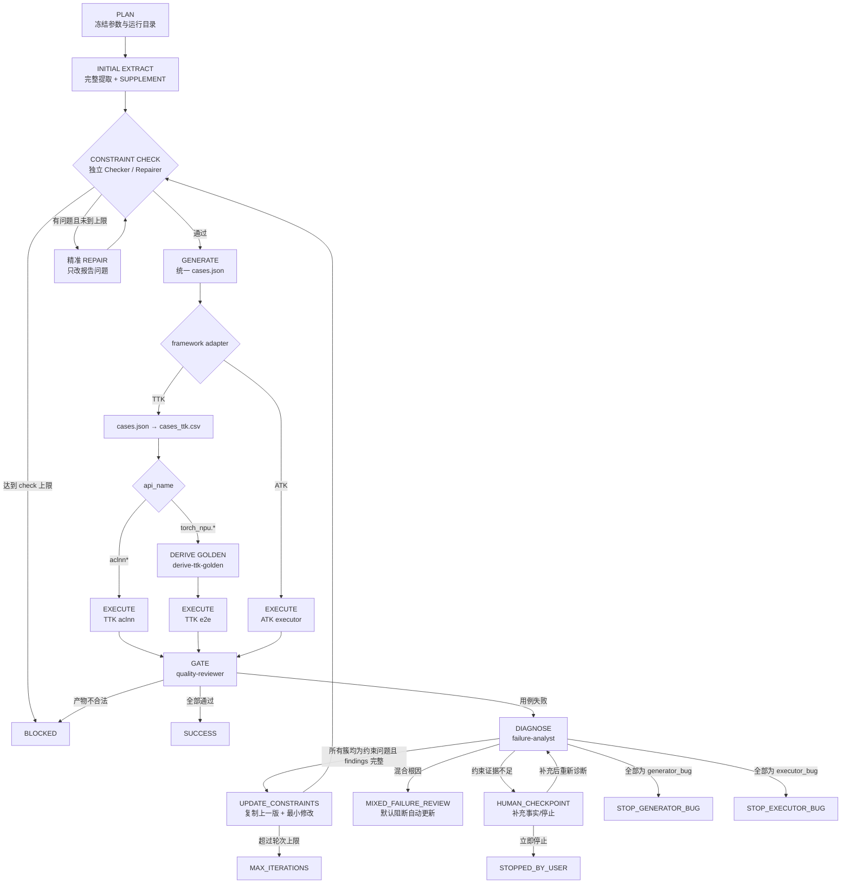

# Claude Code CLI 流程规划与执行设计

## 1. 设计目标

本项目把 Claude Code 作为顶层运行时。规划、专家选择、上下文隔离、阶段调度和循环
判断都在 CLI 中可见；Python 不再创建隐藏 LLM session，只执行可重复的确定性动作。

核心原则：

1. **先规划再执行**：每次 run 先固化参数、阶段、Agent 和终止条件。
2. **角色隔离**：提取、生成、执行、诊断、优化由不同 Agent 独立完成。
3. **文件交接**：Agent 之间只认已校验的落盘产物。
4. **调度可见**：委派文本、CLI Agent 面板、Hooks 和 JSONL 四层观测。
5. **失败按簇分流**：分析全部失败簇；只有全部属于约束问题时才自动增量更新约束，
   生成器/执行器问题立即止损，混合根因默认转人工复核。

## 2. 规划阶段

`/iterate-operator` 先解析并冻结：

| 项 | 默认值 | 规划影响 |
|---|---|---|
| operator-doc | 必填；支持项目外路径 | 初始化时只读快照到 run/inputs |
| prompt | 当前 family 数值版本最新的 vN prompt | 确定首轮提取规则；显式 `--prompt` 可固定原样快照 |
| max-iterations | 5 | 防止无界循环 |
| constraint-check-rounds | 3 | 每个新约束版本（首轮 EXTRACT 或后续 UPDATE_CONSTRAINTS）Checker/Repairer 语义检查修复的最大轮数；通过可提前结束 |
| case-count | 10/平台 | 控制生成与执行规模 |
| mode | real | 缺配置则停止提示；仅显式 `--mode mock` 使用 Mock |
| server-config | servers.json | 真实执行机、平台和环境初始化配置 |
| supplement-constraints | 可选；支持项目外路径 | EXTRACT 后据此做关系补充，为空则跳过补充阶段 |
| operator-family | auto | `torch_npu` 文档自动选 hs，否则 aclnn；CLI 接受 `torch_npu` 作为 hs 别名 |
| test-framework | auto | ACLNN→atk（可显式 ttk）；六个已适配 torch_npu→ttk；其余 torch_npu→constraints-only |
| hs-scenario-mode | original | torch_npu + TTK 默认走原生生成器；显式 planned 才启用场景拆分和投影 |
| source-analysis-knowledge | false | ACLNN 源码分析约束知识默认关闭；显式开启后仍按 `operator_name_eq` 精准命中 |

`init_run.py` 先校验外部文档和真实执行配置。配置不完整时返回结构化提示且不创建
run；校验通过后将外部文档复制为项目内快照并创建 run_state。主协调器必须展示调度
计划，用户能在真正执行前看见：
哪些 Agent 会参与、每个 Agent 接收什么、产出什么、为何停止或继续。

未显式传入 `--prompt` 时，ACLNN 使用 `prompts/operator_constraints/base.md`，由
`scripts/select_prompt.py` 执行预分析、路由 `knowledge/aclnn/manifest.json`、适用性
判断并冻结组装记录；torch_npu 使用 `prompts/torch_npu_constraints/base.md`
（canonical 直接编辑）并装配
`knowledge/torch_npu/**`。两套装配根互斥。源路径、命中模块、哈希和 run 内完整快照
写入 run_state，因此 canonical 后续变化不会静默改变已有 run。

`source_analysis` 类模块额外受 `--source-analysis-knowledge` 门控；默认不装配，
显式开启后也只加载当前算子精确命中的模块。开关、命中证据与模块哈希一起写入
`prompt_assembly.json` 并冻结。执行反馈轮不重新完整提取，因此也不重新路由提示词知识。

## 3. 执行状态机



### CLASSIFY（初始化 EXTRACT barrier 后，非独立状态）

主协调器跑 `python scripts/classify_operator.py --doc <run>/inputs/<doc>.md`，
读 stdout JSON（`operator_category` + `evidence`），运行
`python scripts/run_state.py set-fields --run-dir <run-dir> --set execution_strategy=<fusion|default> --set operator_category=<operator_category> --set operator_category_evidence=<evidence JSON>`
回写 `run_state.json` 的 `execution_strategy`（`fusion_comm_compute` → `fusion`，否则
`default`）、`operator_category`、`operator_category_evidence`。分类不进 constraints.json、
不依赖 constraint-extractor 自由文本。此步初始化时执行一次，后续约束更新沿用分类结果。

### 融合（fusion）执行路径（`run_state.execution_strategy=="fusion"` 时）

EXECUTE 阶段走 4 步融合流程（fusion 走 `_SPECIAL_TEMPLATES` 专属 `.tpl`，已是真实
实现而非 mock；default 路径同样无 golden 推导环节——CPU golden 已在生成时 mock 化，
`atc-cpu-golden-derivation` skill 已废弃）：

1. **generate**：`execute_cases.py --generate`（同 default）；
2. **自检**：`validate_artifacts.py executor`（专属模板为完整实现，自然通过）；
3. **real-run（4 步）**：`--mode real --strategy fusion`——① CPU 标杆(dist/gloo)
   ② NPU 级联标杆(dist/hccl/is_bm) ③ `dist_cpu→cpu_benchmark` 改名
   ④ 精度对比(`accuracy_load`)。每步远程命令完整落 `execution.log`；
   路径门禁（rank_0/rank_1 非空）失败写 `engine_error` 终止；
   精度对比记入 `comparison_result`，**不入成败**——passed/failed 只反映执行成败；
4. **门禁**：`validate_artifacts.py execution` 校验 `execution_strategy=fusion` 时
   `fusion_phases` 非空且 `dir_check_passed` 全真，`comparison_result` 可选。

> default 路径的 EXECUTE 已从「generate → 推导 → real-run」三步简化为
> 「generate → 自检 → real-run」两步：通用模板在生成时直接内联 mock CPU golden
>（按用例 JSON 声明的 output 占位张量返回同 shape/dtype 全零张量，形状感知、
> 不经文档推导），ATK 用其返回物化 NPU 输出张量、kernel 真实执行；精度比对
> 结果无业务语义（对比的是 mock zeros）。`validate_artifacts.py executor` 继续
> 拦截 dummy 标记回归。

## 4. 单轮执行协议

### SCENE_SCAN（强制场景收集，设备优先三段式，EXTRACT 前子步骤）

输入：`inputs/<doc>.md`（只读）、`servers.json`（只读平台并集）。
执行者：主协调器（无独立 Agent）。场景信息来自 `--scenes "<场景描述>"` 预填文本
（原文存 `run_state.scenes`）或交互输入。收集固定分三段，**必须先设备、后场景**：

1. **设备类型（强制）**：读文档"产品支持情况"，列出支持（√）的设备全称；
   `--scenes` 先**只做设备**关键字对齐，对不上/命中多个 → 候选重选；无文本 →
   AskUserQuestion 让用户选择（可多选；文档仅 1 个支持设备时回显确认）。**设备未
   选定前不得读取/展示量化场景、不得写 selection.json、不得渲染 directive、不得
   推进 EXTRACT**。与 `servers.json` platforms 并集比对，无执行机仅警示不阻断。
2. **量化场景（设备确定后）**：主协调器重新读文档，按历史三段式的量化模板规则
   **只识别已选设备下**的场景：场景=具体量化模板（`非量化`/`伪量化`/
   `全量化-A8W8`/`K-C量化（A4W4）`…，按文档原文用词）；"量化模式"等分类词不是
   场景；无设备标注场景合并到该设备；只保留文档给出参数取值约束的场景；过滤
   ACLNN_ERR_*/校验场景；不臆造，**其它设备专属场景不得进入候选**。用
   AskUserQuestion 让用户选择（可多选，"全部"展开为实际场景名）；`--scenes` 文本
   已带场景时先匹配，匹配不上仍让用户选，不得静默接受。该设备无任何量化场景 →
   无场景维度：selection 设备值写 `null`，不得用"非量化"等模板名代替。
3. **参数取值（可选）**：`--scenes` 已给出的先解析，用户可跳过。等值→fix、
   枚举→expand、大白话闭区间→展开整数序列（>32 值提示收窄，开区间话术必须请
   用户给确定上下界）；多场景时统一应用到全部已选场景，用户明确指定时按场景落盘。

AskUserQuestion 回显确认一次（设备全称 / 量化场景 / 参数取值，expand 显示完整
展开结果）后写 `inputs/selection.json`
（`{"device_types":[...],"selection":{device: null|{template: null|{param:[values]}}}}`；
设备值 `null` = 无场景维度，仅按设备收窄），
再运行 `python scripts/render_scene_directive.py --selection <run-dir>/inputs/selection.json --run-dir <run-dir> --scope subset`
做结构校验并渲染 `inputs/scene_directive.md`（机读块
`{device_types, selection, param_modes, no_scene_devices, selection_policy}`）、
回写 `run_state.scene`（`scene.source` = scenes_param / interactive_input）。

**设备必选硬门槛（强制）**：未选出至少一个可对齐文档"产品支持情况"的设备全称，
禁止写 `selection.json`、禁止渲染 directive、禁止推进 EXTRACT；用户明确拒绝提供
设备时确认是否停止任务，不得静默跳过场景步骤继续提取。
`render_scene_directive.py` 对 `device_types` 空返回 `DEVICE_REQUIRED` exit 2、
selection 无任何有效设备条目返回 `EMPTY_SCENE` exit 2（设备值 `null` = 无场景维度，
是合法条目，全"仅设备"选择不触发），此时回到文字匹配重新征询。
`--scope off` 显式禁用场景（不产 directive，纯文档驱动）；批处理
（`iterate-directory`）在认领首个算术前执行**批次级设备确认**（见 §8），确认后把
设备别名 + 场景原文透传给每个单算子 run；每个单算子 run 再按自己的文档识别该设备
下的量化场景并征询用户（批次原文已含唯一匹配场景时只回显确认）。

**legacy 已下线**：基于 `scene_scan.json` 的**全量预扫**场景管线（scene-scanner
Agent 一次性扫全部设备/模板 + Q1→Q2→Q3 逐级征询 + `check_scene_conflicts.py` 冲突
预判 + `--scan`/`--scope all` 渲染路径）已整体删除，禁止调用；`scene-scan` Agent/
Skill、`prompts/scan_scenes.md`、`scripts/check_scene_conflicts.py` 均已移除，原实现
仅存 git 历史。现行“设备优先三段式”只借用其量化模板提取规则，不再做全量预扫。

完成条件：`run_state.scene` 落地 + `inputs/scene_directive.md` 存在（subset）。
失败策略：设备/关键词匹配不上→追问重输；`render_scene_directive.py` exit 2 → 按
`code`/`errors` 修正后重新渲染，不静默回退。

### EXTRACT

输入：run/inputs 中的算子文档快照、prompt_vN，以及（若存在）`inputs/scene_directive.md`。
执行者：constraint-extractor。若 directive 存在，按其 `device_types` 收窄
`product_support`（设备类型为"产品支持情况"具体设备名，直接与文档 √ 行取交集，
无"通用"展开）并按机读块 `param_modes` 收窄用户明确选择的参数
（`{"expand": [取值清单]}` 清单=用户明确选择的子集 /
`{"fix": X}` 单值=用户单值输入或 values[0]）；缺键参数继续按算子文档和已选场景
提取适配，已选场景明确禁止的 Optional 参数必须显式生成 `param is None`；
机读块 `no_scene_devices` 列出的设备（无场景维度）不做场景屏蔽，仅按设备收窄，
不得虚构量化/非量化区分。
该 `product_support` 随后驱动 `generate_cases.py` 逐平台生成。
完成条件：constraints.json 通过 Pydantic/结构校验。
失败策略：同一 Agent 最多自修正三次，之后阻断，不把非法 JSON 传下游。

### EXTRACT fork-join

当 `run_state.operator_src_snapshot` 非空时，EXTRACT 阶段并行委派
`constraint-extractor`（产 `constraints.json`）与 `source-analyst`（产
`source_raw.json` + `supplementary-doc.md`/`uncertain-doc.md`/`conflict-doc.md`/
`conflict_candidates.json`）。两者只读文档快照、互不写对方产物，可并行；barrier
后进 SUPPLEMENT。`operator_src_snapshot` 为空时退回纯文档驱动（只 constraint-extractor）。

### SUPPLEMENT（条件触发，非独立状态）

输入：`inputs/supplementary-doc.md`（source-analyst 产，主源）与/或
`inputs/supplement_constraints.md`（`--supplement-constraints` 手写）+ 已提取
`constraints.json`。两者都空则跳过。  
调度前运行 `update_supplement_state.py` 刷新 run_state 的 revision/hash；合并及检查成功
后以 `--consume` 记录已消费 hash。人工/诊断追加是否为新补充只认脚本的
`changed=true`，不依赖对话上下文。
执行者：constraint-supplementer（产出 `constraints_patch.json`）。  
合并：`scripts/apply_supplement_constraints.py` 确定性合并 patch 进 `constraints.json`
（标 `origin="supplement"`、剥离 patch 层字段、规范化去重并报告 noop），重跑 normalize + validate。
完成条件：合并后 `constraints.json` 通过 normalize + validate。  
失败策略：合并器或 revalidate 失败则阻断，不进 GENERATE；patch schema/精确匹配
失败由 constraint-supplementer 自修正最多三次。
诊断 findings 产生的 patch 在合并前额外运行 `validate_supplement_effect.py`：所有 finding
必须被 patch 覆盖且 patch 不能全量 noop；constraint-checker 再验证失败 case 的预期效果。

### PARAM PIN PROBE（CHECK 前，advisory，非独立状态）

SUPPLEMENT 之后、CONSTRAINT CHECK 之前，运行
`scripts/probe_param_pins.py probe <iter>/constraints.json --decisions <inputs>/param_pins.json`
（文件不存在则省略）。该步检测「`array_length.value` 未固定 + 被跨参数 `len(p)` 引用 + 无传递上界」的列表参数：
生成侧对它们只加 `z3.Length >= 1`，长度完全释放，求解显著变慢。

- 有候选且为交互模式：主协调器**只发起一次** `AskUserQuestion`，题面列出所有候选参数与耦合证据，
  预设 `全部固定为 len == {v0}` / `全部固定为 len == {v1}` / `全部保持自动`
  （`{v0}`/`{v1}` 取组内 `suggested_values`：脚本由约束下界与文档原文中的 batch 数推导，无线索时回落 2/3）。
  Other 支持闭集格式 `a=2`、`a=[2,3]`/`a=2,3`、`a=2~4`/`a=2-4`、`a,b=2`/`a=b=2`、`全部=2`/`统一=2`；
  解析交给 `probe_param_pins.py parse --text "<用户原文>" --probe <iter>/param_probe.json --decisions <inputs>/param_pins.json --decisions-output <inputs>/param_pins.json` 确定性完成；
  **全有或全无**：任一片段失败即整句拒绝（exit 2），不产 patch、不写决策文件并回显格式清单，
  允许带格式重问一次，仍失败则本轮保持自动继续进 CHECK；显式选“保持自动”才记 `auto`。
  解析成功时脚本把决策与已有 `inputs/param_pins.json` 合并落盘，同组原位替换、其它组保留，
  协调器不手工抄写；之后该 run 不再重复提问。
- 存在非 `auto` 决策：`patch` 子命令渲染标准 `constraints_patch`，
  依次执行 `python scripts/validate_artifacts.py constraints_patch <iter>/param_pins_patch.json`
  与 `python scripts/apply_supplement_constraints.py <iter>/constraints.json <iter>/param_pins_patch.json --origin param_pin`，
  再重跑 `probe` 复核 `candidates` 为空，随后进 CHECK。
- 批处理/无头：只写 `<iter>/param_probe.json` 作 advisory，不问询、不产 patch。
- 本步只固定长度，不写逐元素约束；`all()/any()` 量词由生成器在长度静态确定时定长展开为
  逐元素 `And`/`Or`（上限 128，超限仍走量词并在 patch 中发 `large_length_quantifier` 警告）。
  patch 为空、校验失败或合并失败都如实记录但不阻断流程。
- 每个新约束版本（初始化首轮 + 每次 UPDATE_CONSTRAINTS）进 CHECK 前都跑一次；该步先于
  CHECK `passed`，不触发重检规则，若在 `passed` 之后补 pin 则必须重置 CHECK。

### CONSTRAINT CHECK/REPAIR（每个新约束版本的内部子循环）

初始化完整 EXTRACT 在 SUPPLEMENT 和已裁决 conflict 合并完成后，对最终
`constraints.json` 执行语义检查；后续 UPDATE_CONSTRAINTS 产生新版本后也执行同一检查。
该循环不新增顶层状态，分别从属于 EXTRACT 或 UPDATE_CONSTRAINTS：

1. `constraint-checker` 使用隔离上下文读取算子文档、当前最终 constraints、场景指令、
   本轮补充证据和已有 `constraint_check.json`，完整检查整份约束；只写报告、不修改约束。
   aclnn 时每轮先自跑 `verify_relation_exprs.py` 产 `relation_examples.json`，按
   check-constraints 检查规则第 10 条做正反例核对（torch_npu 不跑，行为不变）。
2. 报告无 open/unfixed 问题则通过；有问题且未到 `constraint-check-rounds` 上限时，
   `constraint-repairer` 使用另一个隔离上下文，只 Edit 报告指出的问题并重跑
   validate_operator_rule + normalize + validate_artifacts constraints。
3. 修复后必须由新的 checker 上下文完整复检；只有 checker 可把问题标记 fixed。
4. 默认 3 轮表示 check1 → repair → check2 → repair → check3。达到上限仍失败则顶层
   状态置 `BLOCKED`（code=`CONSTRAINT_CHECK_FAILED`），不得进入 GENERATE。
   已 passed 后若同轮 constraints 又被迟到的 conflict resolution 或人工操作修改，必须
   使旧 passed 失效、重置 check 轮次并检查新版本，不能沿用旧报告结论。

每个 `iter_NNN` 只新增一个 `constraint_check.json`，累计保存问题位置、问题说明、修复
建议及 open/fixed/unfixed 状态。报告必须通过
`python scripts/validate_artifacts.py constraint_check <report>`。未裁决 conflict 保持现有
异步人工通道，不由 checker 自动选边。

### conflict 异步裁决（非阻塞）

source-analyst 产 `conflict-doc.md` 后，若非空，主协调器输出 `requires_user_action`
提示（`code=CONFLICT_REQUIRES_REVIEW`），**不阻塞**主流程，继续 GENERATE。用户在
任意时刻回 `inputs/conflict_resolution.json`，下一次约束更新前由
`scripts/apply_conflict_resolution.py` 把 source-wins 转 replace patch 并入
（`origin="conflict_resolution"` + revalidate）。冲突永远走人工通道，不自动消费。

### GENERATE

输入：已校验 constraints.json 和 run_state.test_framework。
执行者：case-generator。  
动作：所有框架先调用原有 Z3 生成器得到统一 `cases.json`；ATK直接消费，TTK通过
adapter 生成 `cases_ttk.csv` 和转换审计。torch_npu/E2E 额外生成 Golden manifest；
ACLNN 使用 constraints 中的 GetWorkspaceSize 或一段式 callable 签名生成原生 ACLNN CSV。
完成条件：`cases.json` 非空；TTK 还要求 CSV 与 audit 结构合法。
失败策略：不让 LLM 手工“补齐”用例，保留 generator_bug 证据。

长时间生成由脱离会话的 `generation_progress.py launch` 启动。主协调器用 Monitor
执行单条 `generation_progress.py watch --output-dir <iter-absolute> --interval 60`
持续读取结构化进度；Monitor 命令不得包含变量、管道或 shell
`while`/`grep`/`sleep` 循环，避免触发与业务无关的安全审批。Monitor 中断不影响已经
脱离会话的生成进程，之后可重新运行 `watch` 或单次运行 `status` 继续观察。

> **长时间监听脚本必须写成一条裸命令（Claude Code 与 opencode 通用）**：
> 所有长时间监听命令（`generation_progress.py watch`、`watch_constraints_copy.py` 等）
> 一律写成单条裸命令 `<venv-python> <repo>/scripts/<script>.py <args>`——即 python
> 解释器直接跟一个项目内 `.py` 脚本，**不要**用 `Start-Process -FilePath $py -ArgumentList @(...)`、
> `Start-Job`、`& { }` 等 shell/PowerShell 包装。原因：项目的写入守卫
> （`guard_project_writes.py`）只对"python 直接跑项目内 .py"这种裸命令自动放行；
> 一旦用 shell/PowerShell 包装，守卫认不出其中的 .py 入口，会弹用户确认。
> - **Claude Code**：用 `Monitor` 工具（`persistent: true`）挂这条裸命令。**不要改用
>   `run_in_background`**——`run_in_background` 虽也自动放行，但它不会在文件事件出现时
>   唤醒空闲会话；只有 Monitor 能在监听脚本输出事件后把会话唤醒。
> - **opencode**：用 `bash` 工具直接跑同一条裸命令（前台阻塞，给足 `timeout`；超时未出
>   事件就重跑同一条，不轮询、不 kill）。
> - 两种运行时共享同一自动放行规则，命令写法完全一样。

### EXECUTE

输入：已校验 cases.json。  
执行者：case-executor。  
动作：ATK 默认走 SSH/ATK；TTK 根据 CSV `api_name` 自动执行 `ttk aclnn` 或
`ttk e2e`，远程能力未配置时明确阻断。真实 TTK 执行前由服务器 env 初始化命令清理旧
PLOG；执行后无论用例成功或失败，都从 `/root/ascend/log/debug` 同步原始 PLOG，生成
`grep -rn ERROR` 摘要并写入 `execution_result.plog`。
完成条件：execution_result.json 统计自洽。  
失败策略：服务器配置缺失时先提示用户且不执行；其他引擎故障单独写 engine_error，
避免污染用例通过率，禁止自动降级 Mock。

### GATE

输入：本轮全部已生成产物。  
执行者：quality-reviewer。  
动作：结构校验 + 跨文件一致性检查。  
输出：quality_gate.json 和唯一 next_state。  
门禁 Agent 不修复其他 Agent 的产物，避免职责串味。

### DIAGNOSE / UPDATE_CONSTRAINTS

failure-analyst 使用新上下文，只读取落盘事实。当 `operator_src_snapshot` 非空时，
先委派 source-analyst diagnose 域（error_string 模糊匹配失败日志，命中的 uncertain
逐条确认；只有确认成功者追加到 `supplementary-doc.md`，产 `source_evidence.json`），
failure-analyst 读它下根因并按失败签名输出全部 `failure_clusters`、每簇
`recommended_action`、可执行 `constraint_findings`、汇总 `root_cause_summary` 和唯一
`overall_action`。顶层 `root_cause` 仅用于旧消费者兼容，调度器禁止用它覆盖其他失败簇。
真实 TTK 失败必须同时读取 TTK 执行日志和 `execution_result.plog` 指向的 ERROR 摘要/
必要原始日志；PLOG 错误码只有与失败 case、约束和文档交叉验证后才能作为根因证据。

路由规则：

1. 全部失败簇均为 `constraint_extraction`，且 findings 覆盖所有簇 →
   `UPDATE_CONSTRAINTS`。新 iteration 复制上一轮实际生成用例所用的 constraints，保留
   `.pre_update`，由独立 `constraint-updater` 仅处理 findings 并记录
   `constraint_update.json`；随后 CHECK/REPAIR → GENERATE → EXECUTE，禁止重走
   EXTRACT、SUPPLEMENT 或 prompt-optimizer。
2. 全部为 `generator_bug` / `executor_bug` → 分别停止到对应状态。
3. 同时存在两类及以上根因 → `MIXED_FAILURE_REVIEW`，展示全部簇并默认阻断自动修改；
   只有用户明确批准，才能版本化应用其中约束 findings，仍须 CHECK/REPAIR。
4. 全部是约束问题但证据不足以形成 finding → `NEEDS_HUMAN_EVIDENCE`；补充事实后重新
   failure analysis，不重新完整提取。

这样避免执行环境故障反复修改约束，也避免生成器代码 bug 被错误掩盖。TTK 的
UNSUPPORTED/GOLDEN_FAILURE 归入 golden_derivation；CSV映射错误归入 ttk_adapter；
SSH/CANN/TBE/NPU环境归入 execution_environment。

prompt-optimizer 保留为任务结束后的离线知识沉淀能力：可基于多轮证据提出 canonical
prompt/knowledge 改进，但不参与当前 run 的在线失败路由，也不产生新的完整提取轮。

### 人工约束上传通道（`--human-constraints-upload`，默认关闭；由 human-checkpoint 检查点触发）

`init_run.py --human-constraints-upload` 置 `run_state.human_constraints_upload=true`。**前
`human_checkpoint_round` 轮纯自动迭代**（走 UPDATE_CONSTRAINTS 自动更新分支，不挂起）。到达
检查点（`current_iteration >= human_checkpoint_round` 且本轮以 constraint_extraction 失败、
本轮未弹过、`< max_iterations`）时，弹 AskUserQuestion **四选一**：

1. **人工修复**（constraints_copy.json + 监听）→ 进入下方挂起流程；
2. **人工补充**（用户补充事实/证据，append 到 `supplement_constraints.md`，重新诊断）→ 回自动更新；
3. **自动修复**（自主迭代）→ 原 UPDATE_CONSTRAINTS 自动更新；
4. **立即停止** → `STOPPED_BY_USER`。

**此后每个 `>= human_checkpoint_round` 的失败轮都重新弹该四选一**（`human_checkpoint_resolved_iteration`
仅防同一轮重复，不阻断后续新轮再问），用户可逐轮在四种方式间切换。未开启
`--human-constraints-upload` 时检查点退化为三选一（人工修复不可选），向后兼容。

**挂起流程**（用户选「人工修复」时执行）：
1. **挂起**：`state=AWAITING_HUMAN_CONSTRAINTS`，history `HUMAN_CONSTRAINTS_PENDING`。
2. **等待用户上传（agent 不创建文件）**：**不复制**任何约束。告诉用户当前轮只读基线是
   `<iter_N>/constraints.json`；用户据此（或经 web 页面）编辑后把修改后的约束**上传**到
   `<iter_N>/constraints_copy.json`。文件出现 = 已上传、待开启下一轮；文件未出现 = 仍在修改/
   尚未上传，继续等待。
3. **挂监听器**：Monitor 工具（`persistent: true`，单条绝对路径命令、无变量/管道/shell
   循环）挂 `python scripts/watch_constraints_copy.py --run-dir <run-dir>`。监听器轮询
   `iter_<N>/constraints_copy.json` 的**出现 + 稳定性**：启动时文件应缺席——缺席时**继续
   等待、不退出**（缺席 = 未上传）；文件出现后连续两次轮询 mtime/size 不变（≈ interval×2，
   默认 10 秒，防部分写入竞态）才判定上传完成，输出一行 JSON 后**退出**（单次触发后退出：只报告一个事件即结束），
   由 Monitor 把事件送回空闲会话。向用户提示上传目标路径与「上传完成后自动开启下一轮」。
4. **唤醒与接入**：会话被唤醒后运行 `python scripts/apply_human_constraints.py --run-dir <run-dir>`
   （可选 `--max-iterations N` 提升上限，须 > 当前轮次）。该脚本三阶段：
   - 预检（不写盘）：`human_constraints_upload==true`、状态门禁（`AWAITING_HUMAN_CONSTRAINTS`；
     `UPDATE_CONSTRAINTS` 且目标 iter 无生成/执行产物视作已接入未跑的幂等恢复）、
     `target = current_iteration + 1 ≤ max_iterations`；
   - 校验（不写盘）：operator_name 一致性 → `OperatorRule` → `validate_constraints`
     → 归一化 → 复验 → noop 检查（与上一轮约束 canonical-JSON 相等则 `NO_CHANGE`）；
   - 落盘（按序写盘）：建 `iter_<N+1>` → `.pre_update` 备份 + `.submitted` 原样存档 +
     归一化 `constraints.json` → 原子更新 `run_state`（`state=UPDATE_CONSTRAINTS`、
     `current_iteration=N+1`、history `HUMAN_CONSTRAINTS_APPLIED` `origin=human`）→ 消费
     `mv iter_<N>/constraints_copy.json → iter_<N>/constraints_copy.consumed-<ts>.json`。
   前两阶段只读、不碰磁盘，校验失败时什么都没改过，用户改完重新上传/保存再次触发即可（exit 2 + 错误码，文件未消费）。
5. **续跑**：CHECK/REPAIR（人工来源无 findings 清单 → checker 做首轮式完整语义检查）→
   GENERATE → EXECUTE → GATE → DIAGNOSE。若再次以 constraint_extraction 失败且
   `current_iteration >= human_checkpoint_round` → 回到检查点重新弹四选一。终态不变，问环自然结束。

断开恢复：监听器随会话死亡即失效；`claude --continue`（同对话，重新执行第 3 步挂监听器）或
`/iterate-operator --resume-run <run-dir>`（纯文件驱动：`AWAITING`→第 3 步挂监听器等待上传；
`UPDATE_CONSTRAINTS` 且 iter 无生成产物→从 CHECK/REPAIR 续跑）。

### constraints-only

对尚无 TTK adapter 的 torch_npu API，auto 选择 `test_framework=constraints`、
`run_scope=constraints_only`。EXTRACT、可选 SUPPLEMENT 和 CONSTRAINT CHECK/REPAIR 均
通过后才以 `CONSTRAINTS_ONLY_SUCCESS` 事件结束；不进入 GENERATE/EXECUTE，也不要求服务器配置。
该 SUCCESS 只表示约束文件有效，不能报告为用例或精度闭环成功。用户显式选择 `ttk`
仍可用于开发新 adapter，但未注册算子会在生成阶段明确拒绝。

## 5. 串并行设计

主链路有严格数据依赖，EXTRACT、GENERATE、EXECUTE、GATE 必须串行。质量门禁内部的
只读结构检查可以并行，但只能由主协调器发起，且不得让多个 Agent 写同一文件。

在 Claude Code 中可通过 `/agents` 查看正在运行和最近完成的 Agent。若未来把同一算子
的多个平台拆成并行执行，应为每个平台分配独立目录，汇总前执行一次统一门禁。

## 6. 循环与终止

每次状态迁移都更新 `run_state.json`（一律经 `python scripts/run_state.py` 子命令写入，
禁止手动 Edit）。循环只在以下条件同时成立时发生：

- 根因严格等于 constraint_extraction；
- 新提示词已生成并通过基本检查；
- 当前轮次小于 max_iterations；
- quality_gate 没有阻断问题。

其他根因立即停止并给出下一步建议，不自动改代码或重试远端。

## 7. 恢复执行

会话中断后，使用 `claude --continue` 或重新启动 Claude，读取 run_state.json，从最后一个
完成状态继续。任何 Agent 都不得依赖聊天历史恢复事实；产物目录是唯一真相源。
`/iterate-operator --resume-run <run-dir>` 提供全新会话的瘦恢复入口：不创建新 run，
直接读 `<run-dir>/run_state.json` 与 iter 产物判定续跑点（含人工约束上传通道的
`AWAITING_HUMAN_CONSTRAINTS` 挂起状态与 `UPDATE_CONSTRAINTS` 已接入未跑状态）。

## 8. 目录批次

`/iterate-directory` 在单算子状态机外增加一层确定性的串行队列。初始化时一次性冻结
目录、glob、文件顺序、单算子参数和失败策略；随后每次只认领一个文档，并为它创建或
恢复一个独立的 `/iterate-operator` run。

默认批次允许目录混合 ACLNN 与 torch_npu 文档：claim 只透传 `operator-family=auto`，
每个 `init_run` 独立选择对应 baseline 和知识模块。只有用户显式给出 `--prompt` 时才把
同一个原样 prompt 透传整批；这属于用户主动固定版本，不经过 family 模块装配。
扫描 torch_npu 文档目录时，已知导航页 `torch_npu.md`、`torch_npu_list.md` 会被排除，
不会为没有 callable 的索引创建 run。

**批次设备确认（强制，认领前）**：批次不能纯文档驱动提取全部场景。`init_batch` 可带
`--scenes`，但无论是否带，首次 `claim` 在设备未落地时返回 `action=needs_scene`，不会
认领算子。主协调器读取 `inventory.devices` 向用户展示目录内**全部文档的设备并集**
（含别名与逐文档支持情况），让用户**先选择设备**（也可直接输入完整场景文本作为后续
单算子 run 的预填；批次阶段不要求选场景），再调用：

```text
python scripts/batch_scene.py --batch-dir <batch-dir> resolve --scenes "<场景原文>" [--device "<设备族>"] [--skip-unsupported]
```

`batch_scene.py` 解析每篇文档“产品支持情况”（bullet 与表格两种格式），把设备名变体
归并为设备族，输出 `supported` / `partial` / `unsupported` / `not_listed` / `unparsed`
五类逐文档状态。存在不支持、未列出、仅部分支持或无法解析的文档时，必须把算子清单和
原因提示给用户，由用户选择“跳过不支持的文档”（`--skip-unsupported`，标记
`SKIPPED_UNSUPPORTED_DEVICE`）、“仍然全部执行”或“取消批次”。确认后的**设备**写入
`batch_state.scene`；claim 返回的 `scenes` 为“该文档设备别名 + 用户场景原文”，
`iterate-directory` 必须透传 `--scenes`。**量化场景在单算子 run 内按该文档识别**：
同一设备下不同算子文档的量化场景不同，内层 run 读自己的文档识别已选设备下的场景并
让用户选择（SCENE_SCAN 第 2 段）；批次原文已含唯一匹配场景时只回显确认、不重复询问。
这样批次级只确认一次设备，场景选择始终发生在设备确定之后。

默认 `continue-on-error`：`SUCCESS` 计为成功，`BLOCKED`、`MAX_ITERATIONS`、
`STOP_GENERATOR_BUG`、`STOP_EXECUTOR_BUG` 和 `STOPPED_BY_USER` 计为失败，但不会阻止后续文档执行；
`SKIPPED_UNSUPPORTED_DEVICE` 单独计入 skipped，不算失败也不触发 fail-fast。
`--fail-fast` 会在首个非 SUCCESS 终态后把批次置为 STOPPED。这里的“全部执行完毕”
表示所有队列项都进入终态，不等价于全部成功。

批次状态保存在 `runs/batches/<batch-id>/batch_state.json`。当前算子 run 创建后立即
关联 `run_dir`；会话中断时先恢复该 run，完成后再认领下一项。批次脚本不调用 LLM，
只承担扫描、状态迁移和汇总。
